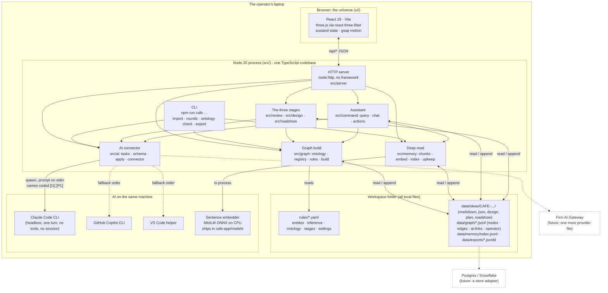
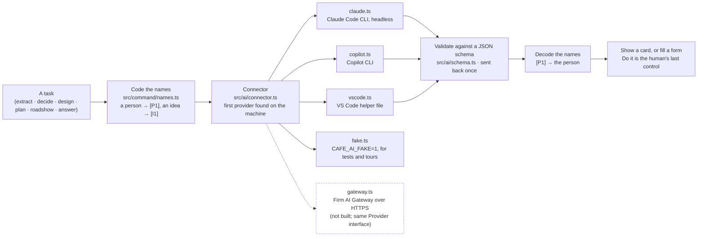
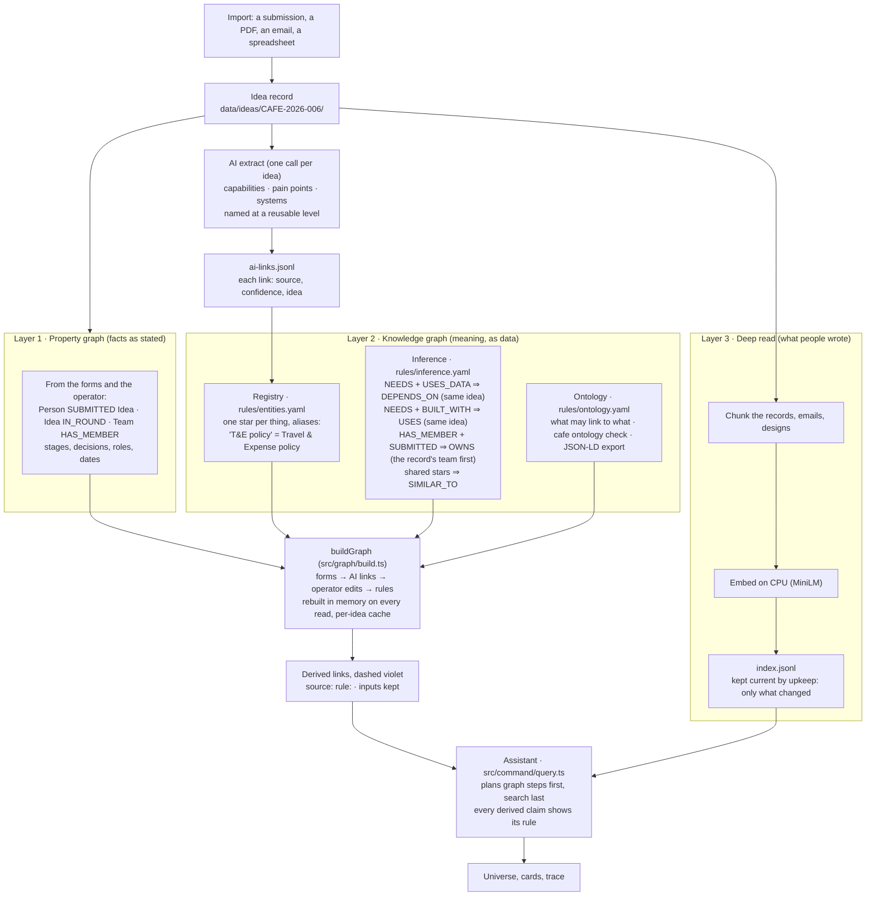
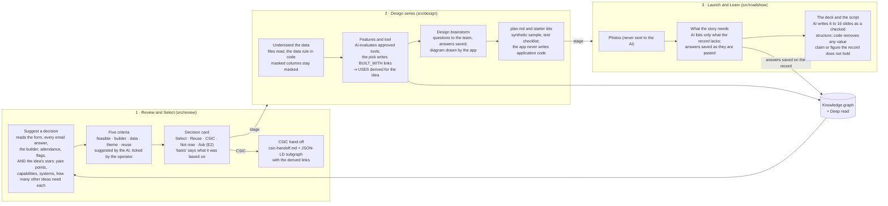
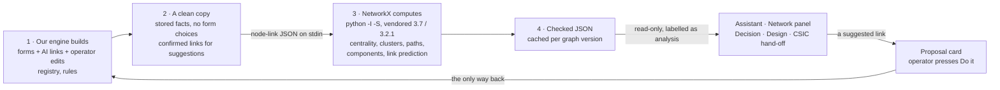

# Creators' Café: an X-ray of the app

**The full illustrated and explained version is [`docs/x-ray.html`](x-ray.html): open it in a browser.** This page is the
short GitHub-rendered view of the same eight sections.

One picture of how the app is built, what it is made of, how the AI is wired in, where the data lives, how the
three stages of an idea use the AI and the graph, and why there are three layers of understanding instead of one.
Everything here is drawn from the code as it stands; the file paths are real so each claim can be checked.

**Purpose.** One operator runs the Creators' Café from their own laptop, with the AI they already have in
their IDE. Nothing is installed on a server, nothing is sent anywhere by the app, and the whole state is a
folder the operator can zip, copy or delete.

## 1. The X-ray

Read it top down. The browser talks only to the local server over JSON. The server, the CLI, the graph build,
Deep read, the AI connector, the assistant and the three stages are one Node process compiled from one TypeScript
tree, so a change in the ontology is seen by the UI, the CLI and the tests at once. The workspace folder is the
only state. The two CLIs are child processes the app spawns on demand, with a scrubbed environment and no tools; the
VS Code helper is an HTTP call on the local machine.

## 2. What it is built from

| Part | Package | Why this one |
|---|---|---|
| Language, everywhere | TypeScript on Node 20 | One language for server, CLI, UI and tests; no second runtime to install on a locked-down PC |
| Server | `node:http` (no framework) | 100 JSON routes registered in one file, and static files; a framework would add more than it removes |
| UI | React 19, Vite | Built once into `web/`, served by the same process |
| The universe | three.js, `@react-three/fiber`, `@react-three/drei`, `@react-three/postprocessing`, gsap | The 3D star field, the glow, the pulses |
| UI state | zustand | Small store, no boilerplate |
| Layout | `d3-force-3d` | Places the stars in the universe |
| Network analysis | NetworkX (vendored wheels, run by the local Python 3.9+) | Centrality, clusters, paths, components, link prediction over the graph the app builds; no download, no numpy |
| Rules | `yaml` | The registry, inference rules, ontology, stages and settings are files the operator can read and edit |
| Import readers | `pdfjs-dist`, `exceljs`, `csv-parse`, `@kenjiuno/msgreader`, `fflate` | Read what people drop in: PDF, Excel, CSV, Outlook `.msg`, zips |
| Deck writer | `pptxgenjs` | Writes the roadshow deck |
| Embeddings | `@huggingface/transformers` (ONNX runtime, CPU) | Deep read's model runs in-process and ships in the repo (`cafe-app/models`, checksummed); the hub, a firm mirror or an import are only for a custom folder or a deleted copy |
| Tests | vitest, jsdom, playwright-core | About 1,080 server tests and about 370 UI tests; the browser is driven headless for acceptance |

About 29,000 lines of TypeScript outside the tests.

## 3. How the AI is connected, and how it would scale

**Today.** The app uses the AI the operator already has for their IDE. The connector tries Claude Code, then the
Copilot CLI, then a VS Code helper, and uses the first one found on the machine. A CLI call is a child process with
the prompt on stdin, every built-in tool disabled, one turn (`--max-turns 1`), no MCP servers, and no session saved,
so the AI can read the prompt and nothing else; reading a picture allows a single Read on that one file in an
otherwise empty folder. The VS Code helper is an HTTP call to a helper on the local machine, found through a port
and token in the operator's home folder. People's names are replaced by codes such as `[P1]` before the prompt is built and put
back after the answer, so a name never leaves the process. Every answer must match a JSON schema or it is sent back
once and then dropped. An answer never changes the graph by itself: a proposed change is a card, and Do it is the
operator's click.

**At firm scale.** A provider is one file that implements `Provider` in `src/ai/connector.ts`: is it available,
and run this prompt. A Firm AI Gateway provider is that file plus an HTTPS call with the firm's token; the coding
of names, the schema check, the retry and the cards stay exactly as they are. Nothing else in the app knows which
provider answered.

## 4. Where the data lives, and how it would scale

Everything is a file in the workspace folder. Idea records are YAML (`idea.yaml`) plus markdown and a history log under `data/ideas/`, one folder
per idea, with the design, the plan, the kits and the roadshow inside it. The graph is JSON lines under
`data/graph/`: what the forms said, what the AI read (`ai-links.jsonl`), and what the operator changed
(`operator.jsonl`, every edit dated, never deleted: an undo flips its status). Deep read's index is three files under
`data/memory/`: `index.jsonl`, `state.json` and `labels.jsonl`. The rules the graph is
built from are YAML under `rules/`.

Two properties follow. The `data/` folder can be deleted and rebuilt from the imports plus the operator log, and
every fact in the graph is traceable to the line that put it there. The same two properties are what a database
would have to keep.

Scaling the storage is a store adapter. The writers are few and named: `src/ideas/store.ts`, `src/graph/store.ts`,
`src/graph/operator.ts`, `src/memory/index.ts`. Each reads a whole file and writes it back, or appends a line.
A Postgres adapter replaces those reads and appends with a table each; Snowflake fits the same seam for the
read-mostly analytics copy. The JSON-LD export (`cafe export`) already gives the graph in a form a graph database
or a warehouse can load today, without the adapter.

## 5. How the AI processes an idea: the three layers

**Property graph.** The facts exactly as stated: who submitted which idea, which round, which team someone is in,
the stage and the decision. Cheap, certain, and already enough for counts, lists and "who is".

**Knowledge graph.** Three small files turn those facts into meaning the app can reason over. The registry gives
every thing one star and a list of names for it, so "T&E policy" and "Travel & Expense policy" are one system and
no twin is ever made. The inference rules derive links that nobody typed: an idea NEEDS a capability and that
capability USES_DATA from a system, so the idea DEPENDS_ON the system. Every stored link carries the ideas it is
stated for, and the rules scope by them: a tool picked in 008's design is 008's, not every idea's that shares the
feature; a team owns the ideas its record names; a capability-level fact nobody scoped applies only to the ideas whose
own facts confirm it. Every derived link records its rule and every way it is derived and is rebuilt on every read;
it can never be stored by hand. Each rebuild writes `nodes.jsonl` and `edges.jsonl` as a snapshot for other tools,
which the app never reads back. The ontology file says what may link to what, so a check can fail (`cafe ontology
check`; `cafe ontology fix` brings an older workspace in line, dry run first), and the export is JSON-LD that RDF
tools read as written: the default graph, links as resources with node IRIs, PROV-O for derivation.

Every route into the graph is gated by the ontology, in the build itself, so it holds for a hand-edited file too: an
operator cannot add an idea, a round, a person or a tool, remove an idea, a team or a person, rename an idea or a
person, make a system a kind of itself or close a loop of kinds, nor store a SUBMITTED, LEADS, BUILT_WITH or derived
link by hand; an AI link must say which AI read it where, give a confidence from 0 to 1 and never pick a tool; nothing
below the confidence threshold counts as confirmed without the operator's Do it, which only the Do it records
(`graph/confirmations.jsonl`), and a pending link never counts as confirmed; an `entities.yaml` id must carry its
section's kind, and no alias can make a not-approved tool a name of an approved one; a NetworkX suggestion is proposed
as one only when NetworkX makes it on the graph as it is. Each refusal drops the fact, is named by `cafe ontology
check` and shown in the app's banner. What it cannot stop: someone who edits two files by hand (an AI link and the
confirmations) can still forge a confirmation; one edited line cannot. The ontology itself is compiled once per build
into a frozen value passed down to the rules, the check, the queries and the export, never a table the app shares,
so builds running at the same time never see each other's. One name is one star:
the id and the lookup key are one normal form (T&E, T/E, T and E and "Travel & Expenses" are Travel & Expense; people
by their exact name, accents kept). The schema is open: `ontology.yaml` may declare a new kind or relation and the
rules may chain it, with no code; `KIND_OF` makes a mailbox count as an email system. The export carries its schema,
an RDFS vocabulary and SHACL shapes at a configurable base (`https://example.invalid/creators-cafe/` by default), and
validates against them with pyshacl and rdf-validate-shacl; a plain triple is a confirmed fact (a link waiting for Do
it is only a reified Link with `cafe:confirmed false`), and a per-idea fact is a plain triple only where it holds for
every idea, so naive SPARQL never reads a fact for an idea it is not true of; the per-idea consequence (idea
DEPENDS_ON system) is a plain triple. SIMILAR_TO is symmetric and written both ways, other names are `skos:altLabel`,
an AI fact carries the passage it was read in (checked against the idea's text) and when, and
`docs/sparql-examples.rq` gives a newcomer's queries with the app's answers. The assistant can say where any link
came from (its `links` step), says "not confirmed" for every link it crossed that waits for Do it, and lets the
registry's names win over a label that merely contains the words (Copilot is Microsoft Copilot, not Copilot Studio).

**Deep read.** The text itself: the challenge, the current process, the emails, the designs, chunked and embedded
on the CPU with a small local model. It answers "what did people write" and "which ideas read alike", and it keeps
itself current by re-reading only the ideas that changed.

The model (`Xenova/all-MiniLM-L6-v2`, about 23 MB) ships in the repo: `cafe-app/models` holds the four files the
quantised load reads, with their SHA-256 in `MANIFEST.json`, so a fresh clone reads with no download. The app looks
in `CAFE_MODEL_DIR`, then `~/.cafe-ai/models`, then the bundled folder, and never writes into the repo
(`src/memory/model.ts`). The Hugging Face hub is contacted only if someone deletes that folder or sets a custom
folder without the model: then the first Run downloads it once into `~/.cafe-ai/models`, and when the firm blocks
that three things replace it: a firm mirror (`CAFE_MODEL_MIRROR`, an internal store serving
`Xenova/all-MiniLM-L6-v2/config.json`, `tokenizer.json`, `tokenizer_config.json` and `onnx/model_quantized.onnx`
under one base URL), a manual import (`cafe model import <folder-or-zip>`) and an export zip (`cafe model export`).
`CAFE_MODEL_OFFLINE=1` forbids any host; a Run without the model then fails at once with one message naming the
three ways in. The scale page (x-ray.html, section 9) says the same: the gateway path does not change where the
model comes from.

### How the engine builds the graph, one idea end to end

The engine rebuilds the whole graph from files on every read, in five steps, in a fixed order, in milliseconds.
NetworkX takes no part in it. Figure 4 in the full page follows the Travel policy assistant through the build.

| Step | File | What it adds | Example: Travel policy assistant |
|---|---|---|---|
| 1. Forms | `ideas/*/idea.yaml` | Typed facts as people stated them, each naming its form column | Lucía Fernández submitted it; GSS has member Lucía Fernández |
| 2. AI links | `graph/ai-links.jsonl` | What the AI read in the free text, checked for ontology types, quote and confidence; low ones wait for Do it | It needs Document text extraction; Document text extraction uses data from the T&E policy |
| 3. Operator edits | `graph/operator.jsonl` | Links, unlinks, renames, aliases and merges, replayed in order; bad ones refused | "T&E policy" merged into "Travel & Expense policy" and kept as its alias |
| Throughout 1 to 3 | `rules/entities.yaml` | The registry: one star per real thing | "T&E policy", "travel policy" and "Travel & Expense policy" are one star |
| 4. Rules, last | `rules/inference.yaml` | Facts nobody wrote, each with its rule and inputs; never stored | Depends on the Travel & Expense policy; GSS owns it; uses Copilot Studio; similar to Procurement FAQ bot |
| 5. Check | `rules/ontology.yaml` | Anything wrong is listed and shown in a banner, never silently kept | |

Derived facts are never stored, only recomputed, so fixing one wrong fact fixes every conclusion drawn from it. Each
source keeps its own file, so it is always clear who said what.

## 6. The three stages: decision, design, roadshow

An idea moves through Review and Select, the Design series, and Launch and Learn. At each stage the AI reads what
the idea holds and suggests; the operator or the team decides; the record grows; the graph and Deep read see the
growth. The same pattern repeats three times: gather, code the names, ask, check in code, show, save on a click.

**Decision.** The suggestion reads everything, not only the form: the team's email answers, whether a builder is
named and can attend, and what the knowledge graph holds for the idea, which is its pain points, capabilities,
systems, and for each one how many other ideas need it. So "Reuse" is suggested when another idea already needs the
same capability, and "CSIC" when the idea depends on a live system that no approved tool may touch. The five criteria
are suggested by the AI (ticked only where the data supports them) and shown as boxes the operator confirms or
changes; the decision is one card, and its basis line says what the suggestion was based on, so a new email visibly
changes it. A CSIC route writes `csic-handoff.md`, with a source line under every field, and `csic-handoff.jsonld`,
the idea's subgraph with its derived links, so the next level starts from the graph and not from a retelling.

**Design.** The tool picker is where the knowledge graph gains facts rather than only serving them. When the team
picks a tool for a capability, the app writes BUILT_WITH links stated for that idea, and the inference rule derives
USES for that idea (another idea that only shares the capability does not inherit the pick). That is what later answers "what breaks if Copilot Studio leaves the approved list".
The data step enforces the Café data rule in code before the AI sees a file, the brainstorm saves the team's
answers on the idea at once, and plan.md and the kits are written from the design, never application code.

**Roadshow.** The AI reads the whole record, the design, the plan and the dates (the record alone: the roadshow does
not query the graph), and lists only what the deck still needs from the team; the answers are saved as they are
pasted and rewrite "learned since the form". The deck is written as a structure the code checks, 6 to 16 slides:
a value claim or a figure the record does not hold is removed, because the Café has no value story, CSIC does.

**What the graph and Deep read add at each stage.** Decision: shared capabilities and systems, with how many other ideas need them, which the
form alone cannot show. Design: the tool pick becomes a fact other ideas inherit. Roadshow: the team's answers become passages Deep read can
quote, so the next question, "what did the team say was hard", finds them. Each stage adds to the record, upkeep re-reads only that idea, and the next
question the operator asks sees it.

## 7. Why three layers, and what plain RAG cannot give

Plain RAG is retrieval: cut the documents into passages, embed them, fetch the nearest few, and let the model
write an answer from them. It is Deep read alone. It is good at "what did the travel desk say about emails" and
poor at everything below, because a passage is not a fact.

| Question the operator actually asks | Plain RAG | This app | Which layer |
|---|---|---|---|
| Who submitted the Procurement FAQ bot, and what stage is it at? | Guesses from whichever passage mentions it | Reads the link and the record | Property graph |
| Which ideas would need rework if the travel policy is rewritten? | Finds passages that mention "policy"; cannot tell dependency from mention | Follows NEEDS then USES_DATA for the same idea, derived by rule, each hop shown | Knowledge graph |
| Which ideas do not depend on any email system? | Cannot answer a negation | DEPENDS_ON from Email and its kinds (KIND_OF: a mailbox is an email system), the rest of the ideas | Knowledge graph |
| Is "T&E policy" the same thing as "Travel & Expense policy"? | Two strings, two retrievals, maybe two answers | One star, by the registry, so one answer | Knowledge graph |
| Which pain point is replaced most often, and does any of those ideas lack a lead? | Cannot count or rank across documents | Rank step over REPLACES, then roles from the records | Property graph |
| Which team owns an idea that has no lead yet? | Nothing to retrieve: it is not written anywhere | OWNS derived from membership plus submission | Knowledge graph |
| Which two ideas are really the same solution? | Similar wording, which is not the same as a shared capability | SIMILAR_TO by shared stars, with the stars named | Knowledge graph |
| What did each submitter say their current process is? | This it does well | Deep read, scoped to the ideas the graph found | Deep read |
| Why does the app believe that? | The passages it fetched | The rule, the input links, and the line in the file that made them | All three, by provenance |

The three layers are not redundant, because each one answers a kind of question the others cannot. The property
graph is certain but literal. The knowledge graph adds identity and inference, with provenance, which is what lets
the assistant say "derived by needs+uses_data" rather than "it seems". Deep read reads prose, which neither graph
can. The assistant plans graph steps first and searches the text last, so an answer is built from facts and
decorated with quotes, not the other way round.

Why not just one bigger layer? Each is small, separately testable, and deletable: the AI links can be re-read,
the index can be rebuilt, the rules can be edited by hand, and none of them blocks the others. A single store that
did all three would be harder to trust and impossible to explain line by line.

## 8. NetworkX for analysis, our own engine for building and reasoning

The challenge was "why not NetworkX". The answer now is both, each doing what it is best at: **the app builds the
graph, NetworkX analyses it.**

How it works, in four steps (Figure 6 in the full page):

Eight examples on the practice workspace, 31 October (worked through in full on the HTML page, with Figure 6
showing what NetworkX sees):

| Question | NetworkX runs | Answer | Why it helps |
|---|---|---|---|
| Which capability holds the most ideas together? | Betweenness centrality | Request handling 0.30 (4 ideas), Document text extraction 0.27 (5 ideas) | The shared building blocks: the strongest reuse case, and the biggest single point of failure |
| How is GSS connected to the Expense system? | Shortest paths, link named on each hop | 4 hops, 2 paths, via Expense anomaly finder and its two capabilities | Who to talk to before the system changes, and through what |
| What do Travel policy assistant and Meeting notes to actions share? | Shortest path between two ideas | 2 hops: both need Document text extraction | Two teams, different wording, one shared component |
| Do the ideas fall into natural groups? | Louvain communities with modularity | Two tentative groups, modularity 0.20: "no clear groups" | The app refuses to present a weak split as real |
| Is anything cut off? | Connected components | One component, all 107 analysed stars connected | Catches an idea or system with no links |
| What links are probably missing? | Link prediction (Adamic-Adar, Jaccard) | None on confirmed evidence (11 considered) | When one fires, it is a proposal with evidence, never a write |
| Design: "Record updating process" typed as a new feature | Link prediction across all ideas | Flagged as Record update, already needed by three other ideas | Stops the same capability being built twice |
| Decision: the AI suggests what to do with an idea | Centrality, grouping verdict, missing links | The suggestion's basis names the network analysis | The decision weighs the whole portfolio |

At seven ideas most of this can be seen by eye. Its value grows with the portfolio: at hundreds of ideas the same
questions run unchanged.

| Job | Who does it | Why |
|---|---|---|
| Build the graph: the form, the AI's links, the operator's edits, registry identities, incremental rebuild | Our engine (`src/graph/build.ts`, `registry.ts`) | Provenance on every link (who said it, confidence, which idea) is domain data the app owns |
| Reason: derived links with their rule and inputs, the ontology, the checks | Our engine (`rules.ts`, `rules/*.yaml`, `check.ts`) | Rules in a fixed order the operator can read, edit and switch off; every derived link explains itself |
| Answer questions step by step with a trace | Our planner (`src/command/query.ts`) | Every answer, count and lit star comes from steps the operator can read |
| Whole-network analysis: betweenness and degree centrality, Louvain clusters with a modularity verdict, shortest paths with the link on each hop, connected components, link prediction (Adamic-Adar, Jaccard), cycles where the ontology lets a relation loop | NetworkX (`py/network.py` via `src/graph/network.ts`) | Standard, well-tested algorithms; no reason to rewrite them |
| Layout | `d3-force-3d` | Places the stars |

How it is wired: the app sends its graph as node-link JSON on stdin to `python -I -S py/network.py`, which imports
NetworkX straight from the official wheels vendored in `cafe-app/vendor/networkx` (3.7 for Python 3.12+, 3.2.1 for
3.9 to 3.11; checksummed in `MANIFEST.json`, BSD-3). Nothing is downloaded, nothing installed on the machine is
used, and only pure-Python algorithms run (no numpy, no scipy). Results are cached per graph version.

- **Stored facts by default.** The analysis reads the form, the AI links and the operator's edits; `--with-derived`
  (or the pop-out's switch) adds what the rules derive. Every output says which, because derived links are
  conclusions, not observations, and an analysis should not count them twice.
- **Human last control.** NetworkX never writes the graph. A suggested link is a proposal the operator accepts with
  the assistant's Do it, and it is labelled "suggested by NetworkX" only when it is among NetworkX's current
  suggestions.
- **Rankings and suggestions that mean something.** Centrality and link prediction leave the form choices (outcomes,
  support, categories, beneficiaries) out by default (`--with-form-choices` keeps them), so the rankings are
  capabilities, systems, people and teams. Link prediction compares two ideas by the capabilities and pain points they
  share and two capabilities by the systems they use, needs two shared stars per peer and two peers per suggestion,
  and reads confirmed links only. A system's "ideas" are the ideas that depend on it.
- **Saying what it found, and what it could not.** Clusters are read from shared capabilities and pain points (form
  choices, people and teams left out) and always come with NetworkX's modularity and a verdict: below 0.3 "no clear
  groups", and then no cluster is passed on as a finding (the practice workspace scores 0.20: no clear groups). Cycles
  are looked for only along relations the ontology lets loop; with the built-in one there are none (Idea → Capability
  → System cannot close, and the build refuses a loop of KIND_OF), so the analysis says so and the UI and assistant do
  not offer it. Paths keep off outcome, support, category and beneficiary hubs.
- **Where it shows up:** `cafe network <check|stats|central|clusters|path A B|isolated|suggest|cycles>`,
  `GET /api/network`, a network step in the assistant ("which capability holds the most ideas together", traced as
  "NetworkX betweenness centrality over stored facts"), the Network pop-out, the decision suggestion (the idea's
  cluster, centrality ranks and likely missing links, said in its basis), the design duplicate check (a feature that
  matches a capability other ideas need, NetworkX's prediction lowering the wording bar), the CSIC hand-off JSON-LD
  (one Analysis node, its content a JSON literal, never links between the stars; an accepted capability → system
  suggestion is stamped with the idea it was suggested for) and `cafe export --format networkx` with
  `docs/networkx-example.py` for analysts.
- **Without Python 3.9+** every NetworkX feature says so in one line and the rest of the app works as before.

