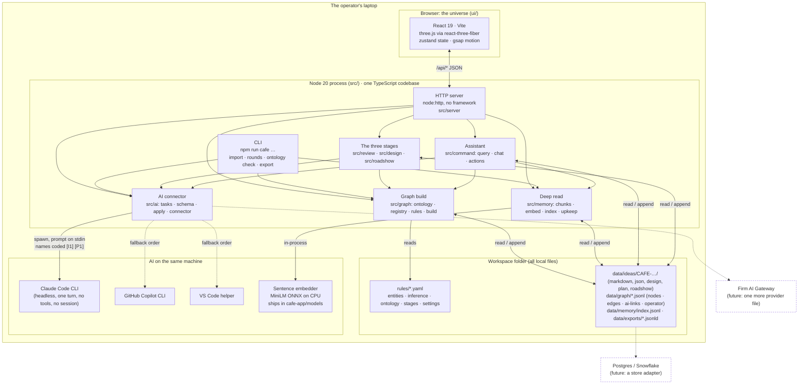
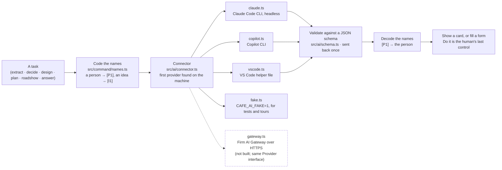
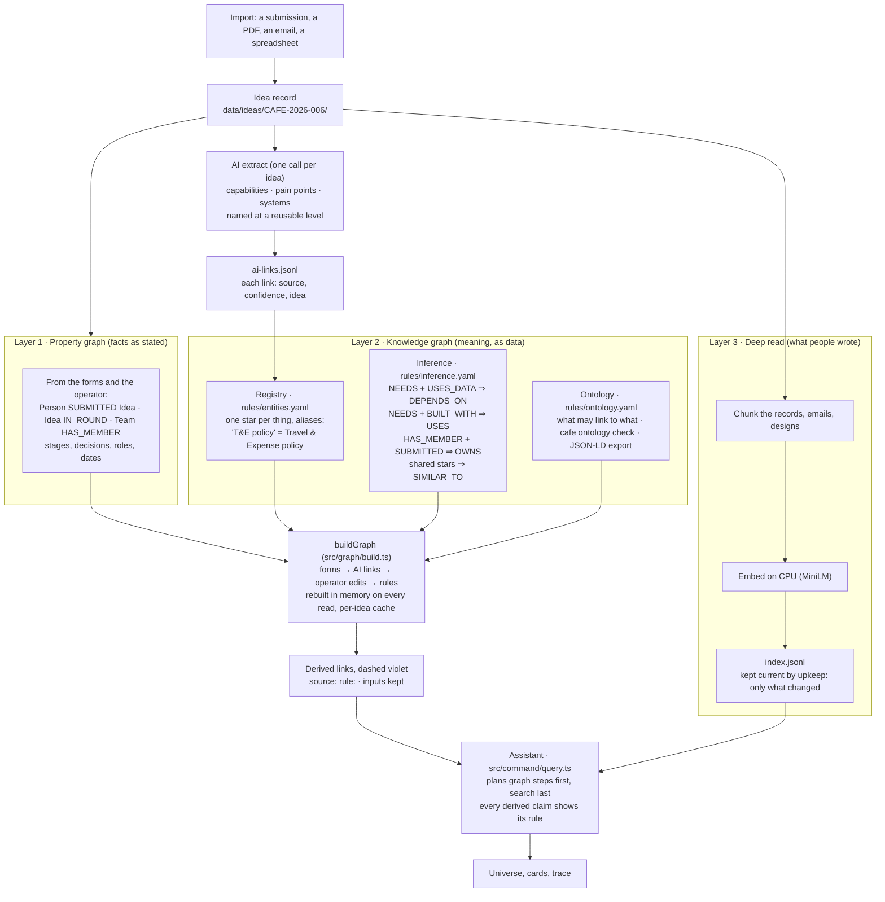
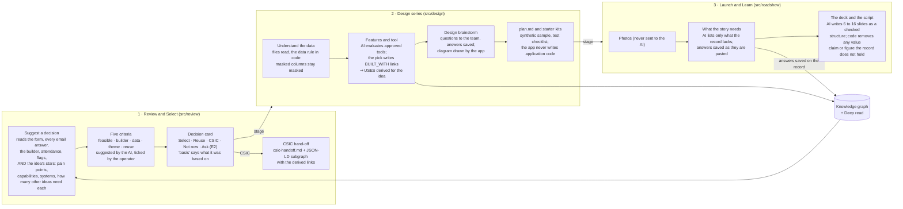

# Creators' Café: an X-ray of the app

**The full illustrated and explained version is [`docs/x-ray.html`](x-ray.html): open it in a browser.** This page is the
short GitHub-rendered view of the same eight sections.

One picture of how the app is built, what it is made of, how the AI is wired in, where the data lives, how the
three stages of an idea use the AI and the graph, and why there are three layers of understanding instead of one.
Everything here is drawn from the code as it stands; the file paths are real so each claim can be checked.

**Purpose.** One operator runs the Creators' Café from their own laptop, with the AI they already have in
their IDE. Nothing is installed on a server, nothing is sent anywhere by the app, and the whole state is a
folder the operator can zip, copy or delete.

## 1. The X-ray

Read it top down. The browser talks only to the local server over JSON. The server, the CLI, the graph build,
Deep read, the AI connector, the assistant and the three stages are one Node process compiled from one TypeScript
tree, so a change in the ontology is seen by the UI, the CLI and the tests at once. The workspace folder is the
only state. The two CLIs are child processes the app spawns on demand, with a scrubbed environment and no tools; the
VS Code helper is an HTTP call on the local machine.

## 2. What it is built from

| Part | Package | Why this one |
|---|---|---|
| Language, everywhere | TypeScript on Node 20 | One language for server, CLI, UI and tests; no second runtime to install on a locked-down PC |
| Server | `node:http` (no framework) | 98 JSON routes registered in one file, and static files; a framework would add more than it removes |
| UI | React 19, Vite | Built once into `web/`, served by the same process |
| The universe | three.js, `@react-three/fiber`, `@react-three/drei`, `@react-three/postprocessing`, gsap | The 3D star field, the glow, the pulses |
| UI state | zustand | Small store, no boilerplate |
| Layout | `d3-force-3d` | Places the stars; the only graph library in the app, and it only does layout |
| Rules | `yaml` | The registry, inference rules, ontology, stages and settings are files the operator can read and edit |
| Import readers | `pdfjs-dist`, `exceljs`, `csv-parse`, `@kenjiuno/msgreader`, `fflate` | Read what people drop in: PDF, Excel, CSV, Outlook `.msg`, zips |
| Deck writer | `pptxgenjs` | Writes the roadshow deck |
| Embeddings | `@huggingface/transformers` (ONNX runtime, CPU) | Deep read's model runs in-process and ships in the repo (`cafe-app/models`, checksummed); the hub, a firm mirror or an import are only for a custom folder or a deleted copy |
| Tests | vitest, jsdom, playwright-core | About 860 server tests and about 370 UI tests; the browser is driven headless for acceptance |

About 29,000 lines of TypeScript outside the tests.

## 3. How the AI is connected, and how it would scale

**Today.** The app uses the AI the operator already has for their IDE. The connector tries Claude Code, then the
Copilot CLI, then a VS Code helper, and uses the first one found on the machine. A CLI call is a child process with
the prompt on stdin, every built-in tool disabled, one turn (`--max-turns 1`), no MCP servers, and no session saved,
so the AI can read the prompt and nothing else; reading a picture allows a single Read on that one file in an
otherwise empty folder. The VS Code helper is an HTTP call to a helper on the local machine, found through a port
and token in the operator's home folder. People's names are replaced by codes such as `[P1]` before the prompt is built and put
back after the answer, so a name never leaves the process. Every answer must match a JSON schema or it is sent back
once and then dropped. An answer never changes the graph by itself: a proposed change is a card, and Do it is the
operator's click.

**At firm scale.** A provider is one file that implements `Provider` in `src/ai/connector.ts`: is it available,
and run this prompt. A Firm AI Gateway provider is that file plus an HTTPS call with the firm's token; the coding
of names, the schema check, the retry and the cards stay exactly as they are. Nothing else in the app knows which
provider answered.

## 4. Where the data lives, and how it would scale

Everything is a file in the workspace folder. Idea records are YAML (`idea.yaml`) plus markdown and a history log under `data/ideas/`, one folder
per idea, with the design, the plan, the kits and the roadshow inside it. The graph is JSON lines under
`data/graph/`: what the forms said, what the AI read (`ai-links.jsonl`), and what the operator changed
(`operator.jsonl`, every edit dated, never deleted: an undo flips its status). Deep read's index is three files under
`data/memory/`: `index.jsonl`, `state.json` and `labels.jsonl`. The rules the graph is
built from are YAML under `rules/`.

Two properties follow. The `data/` folder can be deleted and rebuilt from the imports plus the operator log, and
every fact in the graph is traceable to the line that put it there. The same two properties are what a database
would have to keep.

Scaling the storage is a store adapter. The writers are few and named: `src/ideas/store.ts`, `src/graph/store.ts`,
`src/graph/operator.ts`, `src/memory/index.ts`. Each reads a whole file and writes it back, or appends a line.
A Postgres adapter replaces those reads and appends with a table each; Snowflake fits the same seam for the
read-mostly analytics copy. The JSON-LD export (`cafe export`) already gives the graph in a form a graph database
or a warehouse can load today, without the adapter.

## 5. How the AI processes an idea: the three layers

**Property graph.** The facts exactly as stated: who submitted which idea, which round, which team someone is in,
the stage and the decision. Cheap, certain, and already enough for counts, lists and "who is".

**Knowledge graph.** Three small files turn those facts into meaning the app can reason over. The registry gives
every thing one star and a list of names for it, so "T&E policy" and "Travel & Expense policy" are one system and
no twin is ever made. The inference rules derive links that nobody typed: an idea NEEDS a capability and that
capability USES_DATA from a system, so the idea DEPENDS_ON the system, scoped to the idea the AI read it from.
Every derived link records its rule and its inputs and is rebuilt on every read; each rebuild writes `nodes.jsonl` and
`edges.jsonl` as a snapshot for other tools, which the app never reads back. The ontology
file says what may link to what, so a check can fail, and the export is JSON-LD that other tools read.

**Deep read.** The text itself: the challenge, the current process, the emails, the designs, chunked and embedded
on the CPU with a small local model. It answers "what did people write" and "which ideas read alike", and it keeps
itself current by re-reading only the ideas that changed.

The model (`Xenova/all-MiniLM-L6-v2`, about 23 MB) ships in the repo: `cafe-app/models` holds the four files the
quantised load reads, with their SHA-256 in `MANIFEST.json`, so a fresh clone reads with no download. The app looks
in `CAFE_MODEL_DIR`, then `~/.cafe-ai/models`, then the bundled folder, and never writes into the repo
(`src/memory/model.ts`). The Hugging Face hub is contacted only if someone deletes that folder or sets a custom
folder without the model: then the first Run downloads it once into `~/.cafe-ai/models`, and when the firm blocks
that three things replace it: a firm mirror (`CAFE_MODEL_MIRROR`, an internal store serving
`Xenova/all-MiniLM-L6-v2/config.json`, `tokenizer.json`, `tokenizer_config.json` and `onnx/model_quantized.onnx`
under one base URL), a manual import (`cafe model import <folder-or-zip>`) and an export zip (`cafe model export`).
`CAFE_MODEL_OFFLINE=1` forbids any host; a Run without the model then fails at once with one message naming the
three ways in. The scale page (x-ray.html, section 9) says the same: the gateway path does not change where the
model comes from.

## 6. The three stages: decision, design, roadshow

An idea moves through Review and Select, the Design series, and Launch and Learn. At each stage the AI reads what
the idea holds and suggests; the operator or the team decides; the record grows; the graph and Deep read see the
growth. The same pattern repeats three times: gather, code the names, ask, check in code, show, save on a click.

**Decision.** The suggestion reads everything, not only the form: the team's email answers, whether a builder is
named and can attend, and what the knowledge graph holds for the idea, which is its pain points, capabilities,
systems, and for each one how many other ideas need it. So "Reuse" is suggested when another idea already needs the
same capability, and "CSIC" when the idea depends on a live system that no approved tool may touch. The five criteria
are suggested by the AI (ticked only where the data supports them) and shown as boxes the operator confirms or
changes; the decision is one card, and its basis line says what the suggestion was based on, so a new email visibly
changes it. A CSIC route writes `csic-handoff.md`, with a source line under every field, and `csic-handoff.jsonld`,
the idea's subgraph with its derived links, so the next level starts from the graph and not from a retelling.

**Design.** The tool picker is where the knowledge graph gains facts rather than only serving them. When the team
picks a tool for a capability, the app writes BUILT_WITH links, and the inference rule derives USES for every idea
that needs that capability. That is what later answers "what breaks if Copilot Studio leaves the approved list".
The data step enforces the Café data rule in code before the AI sees a file, the brainstorm saves the team's
answers on the idea at once, and plan.md and the kits are written from the design, never application code.

**Roadshow.** The AI reads the whole record, the design, the plan and the dates (the record alone: the roadshow does
not query the graph), and lists only what the deck still needs from the team; the answers are saved as they are
pasted and rewrite "learned since the form". The deck is written as a structure the code checks, 6 to 16 slides:
a value claim or a figure the record does not hold is removed, because the Café has no value story, CSIC does.

**What the graph and Deep read add at each stage.** Decision: shared capabilities and systems, with how many other ideas need them, which the
form alone cannot show. Design: the tool pick becomes a fact other ideas inherit. Roadshow: the team's answers become passages Deep read can
quote, so the next question, "what did the team say was hard", finds them. Each stage adds to the record, upkeep re-reads only that idea, and the next
question the operator asks sees it.

## 7. Why three layers, and what plain RAG cannot give

Plain RAG is retrieval: cut the documents into passages, embed them, fetch the nearest few, and let the model
write an answer from them. It is Deep read alone. It is good at "what did the travel desk say about emails" and
poor at everything below, because a passage is not a fact.

| Question the operator actually asks | Plain RAG | This app | Which layer |
|---|---|---|---|
| Who submitted the Procurement FAQ bot, and what stage is it at? | Guesses from whichever passage mentions it | Reads the link and the record | Property graph |
| Which ideas would need rework if the travel policy is rewritten? | Finds passages that mention "policy"; cannot tell dependency from mention | Follows NEEDS then USES_DATA, derived by rule, each hop shown | Knowledge graph |
| Is "T&E policy" the same thing as "Travel & Expense policy"? | Two strings, two retrievals, maybe two answers | One star, by the registry, so one answer | Knowledge graph |
| Which pain point is replaced most often, and does any of those ideas lack a lead? | Cannot count or rank across documents | Rank step over REPLACES, then roles from the records | Property graph |
| Which team owns an idea that has no lead yet? | Nothing to retrieve: it is not written anywhere | OWNS derived from membership plus submission | Knowledge graph |
| Which two ideas are really the same solution? | Similar wording, which is not the same as a shared capability | SIMILAR_TO by shared stars, with the stars named | Knowledge graph |
| What did each submitter say their current process is? | This it does well | Deep read, scoped to the ideas the graph found | Deep read |
| Why does the app believe that? | The passages it fetched | The rule, the input links, and the line in the file that made them | All three, by provenance |

The three layers are not redundant, because each one answers a kind of question the others cannot. The property
graph is certain but literal. The knowledge graph adds identity and inference, with provenance, which is what lets
the assistant say "derived by needs+uses_data" rather than "it seems". Deep read reads prose, which neither graph
can. The assistant plans graph steps first and searches the text last, so an answer is built from facts and
decorated with quotes, not the other way round.

Why not just one bigger layer? Each is small, separately testable, and deletable: the AI links can be re-read,
the index can be rebuilt, the rules can be edited by hand, and none of them blocks the others. A single store that
did all three would be harder to trust and impossible to explain line by line.

## 8. Why not NetworkX

A fair challenge: NetworkX is the standard graph library in Python. The answer is fit, not fashion.

- **One runtime.** The app is one TypeScript codebase on Node: server, CLI, UI and tests. NetworkX would add a
  Python install and a process boundary, with the graph serialised across it on every call. On a locked-down PC
  that is a second thing to get approved.
- **The graph is small and rebuilt, not stored.** A round is hundreds of stars and a few hundred links, rebuilt
  from files in milliseconds on every read, with a per-idea cache. What the app needs is typed nodes and edges,
  provenance on every link, rules applied in order, incremental rebuild and layout. That is `src/graph/build.ts`
  with plain arrays and maps, plus `rules/*.yaml`. NetworkX's strength is algorithms over large graphs:
  centrality, communities, shortest paths. The app runs none of them today.
- **Provenance is the point.** Every link carries who said it, with what confidence, from which idea, and every
  derived link carries its rule and inputs. That is domain data the app owns; a general graph library would hold it
  as an attribute bag and the rules would still have to be written by hand.
- **The one graph library in use does one job.** `d3-force-3d` places the stars in the universe. Layout is the
  only place an algorithm was needed, so that is the only place a library was added.
- **The door is open.** `cafe export` writes JSON-LD, which NetworkX, Neo4j, or a warehouse can load for analysis
  at any time, without touching the app. If a future round reaches thousands of ideas and the questions turn to
  "which capability is the hub" or "which cluster of ideas forms a programme", the honest answer is a JS library
  such as graphology for those algorithms, or Neo4j behind the store adapter, chosen when the question exists.

So: not a better NetworkX, but a smaller thing that does what this app needs, explains itself, and exports to
NetworkX the day someone needs it.
